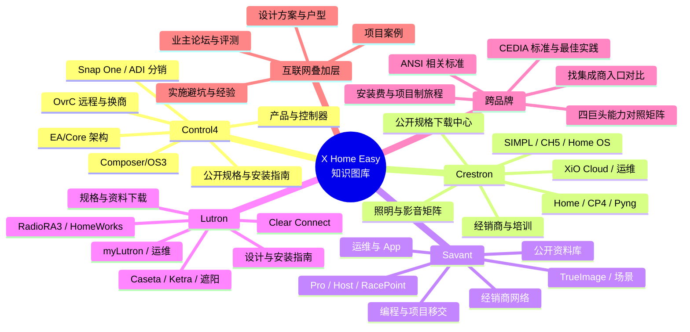

# X Home Easy 知识图库 · 思维导图

## 数据记录模板（每条）
| 字段 | 说明 |
|------|------|
| id | 如 `c4-prod-001` |
| brand | Control4 / Crestron / Savant / Lutron / Cross |
| layer | official / internet |
| category | products / architecture / install / programming / ops / partner / case / experience |
| title | 标题 |
| source_url | 原文 URL |
| fetched_on | Asia/Shanghai 日期 |
| local_path | 相对 Doc 的路径 |
| notes | 摘要（中文） |
